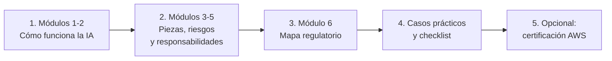

# IA para Abogados — Entender la Inteligencia Artificial desde el Derecho

[](abogados/README.md)
[](https://aws.amazon.com/certification/certified-ai-practitioner/)
[](#cómo-usar-esta-guía)
[](abogados/06-mapa-regulatorio.md)
[](https://github.com/FRANK1808K/AWS-IA-PRACTITIONER-EN-ESPA-OL/actions/workflows/docs-lint.yml)

Una guía en español para **abogados, juristas y estudiantes de Derecho** que quieren entender **cómo funciona realmente la inteligencia artificial** (qué es un modelo, por qué "alucina", qué piezas tiene una solución en la nube) y **qué preguntas jurídicas plantea cada pieza**. No hace falta saber programar.

El objetivo es formar **perfiles puente entre el derecho y la tecnología**: profesionales capaces de conversar con ingenieros, revisar contratos de IA con criterio técnico, asesorar sobre cumplimiento y anticipar los litigios que vienen.

> **Origen:** esta rama adapta un repositorio de preparación para la certificación **AWS Certified AI Practitioner (AIF-C01)**. El contenido técnico original se conserva como "nivel avanzado" y como material para quien quiera certificarse.
>
> ⚠️ **Aviso:** material educativo, no asesoramiento jurídico. Proyecto comunitario no afiliado a Amazon Web Services. La regulación de la IA cambia con rapidez: verifica siempre las fuentes oficiales vigentes.

---

## ¿Por qué un abogado debería entender la IA?

| Situación | Lo que se espera de ti |
|---|---|
| Un cliente quiere **contratar una herramienta de IA** | Saber qué preguntar sobre datos, seguridad, propiedad intelectual y responsabilidad |
| Una empresa usa IA para **decidir sobre personas** (crédito, empleo, seguros) | Evaluar riesgos de discriminación, explicabilidad y derechos de los afectados |
| Llega un **litigio** donde una IA intervino | Saber qué pruebas pedir: registros, documentación del modelo, evaluaciones de sesgo |
| Tu despacho quiere **usar IA** | Proteger el secreto profesional y evitar sanciones por citas inventadas |
| Se aprueba una **nueva ley de IA** | Entender a qué sistemas y actores se aplica en la práctica |

## Cómo usar esta guía



### Ruta principal: [Guía de IA para Abogados](abogados/README.md)

| Módulo | Pregunta que responde |
|---|---|
| [1. ¿Qué es la IA y cómo "aprende"?](abogados/01-que-es-la-ia.md) | ¿Qué diferencia hay entre IA, machine learning, IA generativa e IA agéntica? ¿Por qué se equivoca? |
| [2. IA generativa](abogados/02-ia-generativa.md) | ¿Cómo "escribe" un ChatGPT o un Claude y por qué inventa sentencias? |
| [3. Cómo se construye una solución en la nube](abogados/03-soluciones-en-la-nube.md) | ¿Quién es quién en la cadena de proveedores y qué hace cada pieza? |
| [4. IA responsable](abogados/04-ia-responsable.md) | ¿Cómo se relacionan sesgo, explicabilidad y transparencia con la igualdad y el deber de motivación? |
| [5. Seguridad y gobernanza](abogados/05-seguridad-y-gobernanza.md) | ¿Quién responde de qué y qué registros sirven de prueba? |
| [6. Mapa regulatorio](abogados/06-mapa-regulatorio.md) | AI Act tras el *Digital Omnibus*, América Latina, propiedad intelectual y deontología |

### Herramientas de trabajo

| Herramienta | Para qué sirve |
|---|---|
| [Casos prácticos](abogados/casos-practicos.md) | Cinco situaciones de asesoramiento: el asistente del despacho, el crédito discriminatorio, el agente que reembolsó demasiado, la transcripción de audiencias y el logo generado por IA |
| [Checklist de contratación de IA](abogados/checklist-contratacion-ia.md) | Due diligence para revisar un proveedor o una herramienta de IA |
| [Glosario traductor](abogados/glosario-traductor.md) | Cada término técnico explicado y relacionado con su concepto jurídico |

---

## Si además quieres certificarte

La certificación **AWS Certified AI Practitioner (AIF-C01)** acredita que entiendes la IA, la IA generativa y los servicios de AWS **sin necesidad de programar**. Para un abogado es un aval útil para especializarse en derecho tecnológico. Cada módulo de la guía indica a qué dominio del examen equivale.

| Dato del examen | Valor |
|---|---|
| Preguntas / duración | 65 preguntas en 90 minutos (120 con la adaptación ESL +30 si lo haces en inglés) |
| Aprobado | 700 sobre 1000 |
| Idiomas | Incluye **español** (Latinoamérica y España) |
| Costo | USD 100 |

| Material de preparación | Enlace |
|---|---|
| Teoría técnica por dominio | [`domains/`](domains/) (empieza por las [novedades de la guía v1.1](domains/00-exam-guide-v1.1-changes.md)) |
| Simulador interactivo con cronómetro y versión en inglés | [`simulator/`](simulator/README.md) |
| Simulacros de 65 preguntas | [Simulacro 01](practice-questions/mock-exam-01.md) · [Simulacro 02](practice-questions/mock-exam-02.md) |
| Repaso rápido | [Pares que se confunden](cheatsheets/confusable-pairs.md) · [Matriz de decisión](cheatsheets/exam-decision-matrix.md) · [Repaso final 48 h](cheatsheets/final-review-48h.md) |
| Flashcards para Anki | [`flashcards/`](flashcards/README.md) |
| Estrategia del examen | [Playbook del examen](guides/exam-playbook.md) · [Plan de reintento](guides/retake-plan.md) |
| Cursos, videos y recursos externos | [Centro de recursos](resources/README.md) |
| Laboratorio técnico (opcional, requiere cuenta de AWS) | [Lab 01 — RAG con Bedrock](labs/lab-01-rag-bedrock-knowledge-bases/README.md) |

---

## Estructura del repositorio

```text
.
├── README.md                     # Esta página: guía para abogados
├── abogados/                     # ⭐ Ruta principal en lenguaje llano
│   ├── README.md                 # Índice y ruta de lectura
│   ├── 01-que-es-la-ia.md
│   ├── 02-ia-generativa.md
│   ├── 03-soluciones-en-la-nube.md
│   ├── 04-ia-responsable.md
│   ├── 05-seguridad-y-gobernanza.md
│   ├── 06-mapa-regulatorio.md
│   ├── casos-practicos.md
│   ├── checklist-contratacion-ia.md
│   └── glosario-traductor.md
├── domains/                      # Nivel técnico: los 5 dominios del examen AIF-C01
├── simulator/                    # Simulador de examen interactivo
├── practice-questions/           # Simulacros y preguntas por dominio (también en inglés)
├── cheatsheets/                  # Repaso rápido para el examen
├── flashcards/                   # Tarjetas para Anki/Quizlet
├── guides/                       # Estrategia del examen
├── resources/                    # Cursos, videos, libros y recursos oficiales
└── labs/                         # Laboratorio técnico (requiere cuenta de AWS)
```

## Cómo contribuir

¿Eres abogado, docente o estudiante y quieres aportar un caso práctico, actualizar el mapa regulatorio de tu país o mejorar una explicación? Abre un *issue* o un *pull request*. Reglas básicas:

- **Lenguaje llano:** explica cada término técnico la primera vez que aparece.
- **Fuentes verificables:** toda afirmación normativa o jurisprudencial debe citar una fuente oficial o de referencia, con fecha.
- **Sin datos reales de clientes ni de personas:** los casos prácticos son ficticios.
- Más detalles de estilo en [`CONTRIBUTING.md`](CONTRIBUTING.md).
