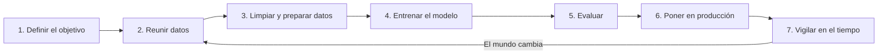

# Módulo 1 — ¿Qué es la inteligencia artificial y cómo "aprende"?

> **Equivale a:** Dominio 1 del examen AWS AIF-C01 (20 %). Versión técnica: [Dominio 1](../domains/01-fundamentals-ai-ml/README.md).
>
> **Lo que sabrás al terminar:** distinguir IA, machine learning, deep learning, IA generativa e IA agéntica; entender cómo se "entrena" un modelo; y saber por qué un modelo puede equivocarse o discriminar, que es donde empiezan los problemas jurídicos.

---

## 1. La idea central en una frase

Un sistema tradicional sigue **reglas que alguien escribió** ("si el cliente tiene más de 18 años, aprobar"). Un sistema de **machine learning** (aprendizaje automático) **deduce sus propias reglas a partir de ejemplos**: le muestras miles de casos resueltos y encuentra los patrones.

> **Analogía jurídica:** el sistema tradicional se parece a aplicar el **texto literal de la ley**. El machine learning se parece más a un jurista que **lee miles de sentencias** e infiere cómo suelen resolverse los casos, pero sin poder citar el artículo que justifica cada conclusión. Ahí nace el problema de la **explicabilidad**.

## 2. Las "muñecas rusas" de la IA

```text
┌──────────────────────────────────────────────────────────────┐
│ INTELIGENCIA ARTIFICIAL: máquinas que realizan tareas que    │
│ normalmente requieren inteligencia humana                    │
│  ┌────────────────────────────────────────────────────────┐  │
│  │ MACHINE LEARNING: aprende patrones a partir de datos   │  │
│  │  ┌──────────────────────────────────────────────────┐  │  │
│  │  │ DEEP LEARNING: "redes neuronales" de muchas capas│  │  │
│  │  │ capaces de entender imágenes, voz y texto        │  │  │
│  │  │  ┌────────────────────────────────────────────┐  │  │  │
│  │  │  │ IA GENERATIVA: crea contenido nuevo        │  │  │  │
│  │  │  │ (textos, imágenes, audio, código)          │  │  │  │
│  │  │  └────────────────────────────────────────────┘  │  │  │
│  │  └──────────────────────────────────────────────────┘  │  │
│  └────────────────────────────────────────────────────────┘  │
└──────────────────────────────────────────────────────────────┘
```

| Término | En lenguaje llano | Ejemplo cotidiano |
|---|---|---|
| **IA** | Cualquier técnica que imita capacidades humanas | Un sistema de reglas que clasifica expedientes |
| **Machine learning** | Aprende de ejemplos en lugar de seguir reglas escritas | Un modelo que predice qué clientes dejarán de pagar |
| **Deep learning** | Machine learning muy potente para datos "desordenados" (fotos, voz, textos) | Reconocer una firma o transcribir una audiencia |
| **IA generativa** | Crea contenido nuevo | ChatGPT o Claude redactando un borrador de contrato |
| **IA agéntica** | IA que, además de responder, **actúa**: planifica pasos, usa herramientas y ejecuta tareas | Un asistente que consulta un registro, rellena un formulario y agenda una cita por sí solo |

> **Por qué importa al abogado:** cuanto más "autónomo" es el sistema (de reglas → ML → generativo → agéntico), más difícil es **atribuir responsabilidad**, **explicar decisiones** y **controlar** lo que hace. La IA agéntica plantea preguntas nuevas de **mandato, representación y responsabilidad por actos de un sistema**.

## 3. Las tres formas de aprender

| Tipo | Cómo aprende | Analogía | Uso típico | Riesgo jurídico típico |
|---|---|---|---|---|
| **Supervisado** | Con ejemplos **etiquetados** (casos con su respuesta correcta) | Estudiar con exámenes resueltos | Aprobar créditos, detectar fraude, clasificar documentos | Si las etiquetas históricas eran discriminatorias, el modelo **aprende la discriminación** |
| **No supervisado** | Sin respuestas: busca grupos o anomalías por sí mismo | Ordenar una biblioteca sin catálogo, agrupando por parecido | Segmentar clientes, detectar operaciones inusuales | Grupos que coinciden con categorías protegidas (origen, edad) |
| **Por refuerzo** | Prueba y error con premios y castigos | Adiestramiento con recompensas | Robots, juegos, optimización de rutas | Comportamientos inesperados para "ganar" el premio |

## 4. Cómo nace un modelo: el ciclo de vida



| Fase | Qué ocurre | Preguntas que debe hacer un abogado |
|---|---|---|
| **1. Objetivo** | Se define qué se quiere predecir o decidir | ¿Es una decisión con efectos jurídicos sobre personas? ¿Es lícita la finalidad? |
| **2. Datos** | Se recopilan los ejemplos | ¿Hay base legal para usar esos datos? ¿Consentimiento? ¿Datos sensibles? ¿Derechos de autor? |
| **3. Preparación** | Se depuran y organizan | ¿Se anonimizaron los datos personales? ¿Se documentó el origen (trazabilidad)? |
| **4. Entrenamiento** | El modelo "aprende" | ¿Quién es titular del modelo resultante? ¿Quién entrenó y con qué licencia? |
| **5. Evaluación** | Se mide su acierto | ¿Se midió el sesgo por grupos? ¿Quién aprobó el paso a producción? |
| **6. Producción** | Se usa con personas reales | ¿Se informa a los afectados? ¿Hay revisión humana en decisiones relevantes? |
| **7. Vigilancia** | Se controla que siga funcionando bien | ¿Hay monitoreo y un procedimiento para corregir o retirar el sistema? |

> **Idea clave:** el **dato** es la materia prima. Casi todos los problemas legales de la IA (privacidad, discriminación, propiedad intelectual) **entran por los datos**.

## 5. ¿Cómo se sabe si un modelo "acierta"? (sin fórmulas)

Un modelo nunca acierta al 100 %. Lo importante es **qué tipo de error comete** y **a quién perjudica**.

| Error | Qué significa | Ejemplo en un sistema antifraude | ¿A quién perjudica? |
|---|---|---|---|
| **Falso positivo** | Acusa a quien no debía | Bloquea la tarjeta de un cliente honesto | Al ciudadano inocente |
| **Falso negativo** | Deja pasar lo que debía detectar | No detecta un fraude real | A la víctima o a la empresa |

> **Analogía jurídica:** es el viejo dilema de la justicia penal. Un sistema que prioriza "**no condenar inocentes**" acepta que algunos culpables escapen, y al revés. En IA, ese equilibrio se fija con métricas técnicas (*precision* y *recall*). **Quien elige la métrica toma una decisión de política pública**, aunque parezca técnica.

## 6. Cuándo NO conviene usar IA

- Cuando la respuesta debe ser **exacta y determinista** (calcular un plazo procesal o un impuesto): una regla es más segura y auditable.
- Cuando no hay **datos suficientes o fiables**.
- Cuando la decisión **debe poder explicarse caso por caso** y el modelo no lo permite.
- Cuando el riesgo para los derechos de las personas **supera el beneficio**.

> 🆕 La guía oficial del examen pregunta expresamente **cuándo usar ML "tradicional" en vez de IA generativa**. Para decisiones reguladas sobre datos estructurados (crédito, seguros, contratación) suele preferirse un modelo tradicional, que es **más explicable y auditable**.

## 7. Para reflexionar

1. Un banco entrena un modelo de crédito con 20 años de decisiones de sus analistas. ¿Qué riesgo jurídico aparece si esos analistas discriminaban?
2. Un sistema de selección de personal "acierta" el 95 % de las veces. ¿Basta ese dato para considerarlo justo? ¿Qué más preguntarías?
3. ¿Quién debería responder si un agente de IA, actuando "por su cuenta", firma una reserva que el usuario no quería?

➡️ Siguiente: [Módulo 2 — IA generativa](02-ia-generativa.md)
