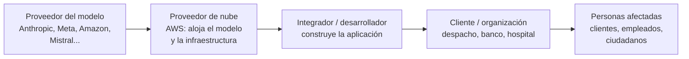

# Módulo 3 — Cómo se construye una solución de IA en la nube (y quién es quién)

> **Equivale a:** Dominio 3 del examen AWS AIF-C01 (28 %, el de mayor peso). Versión técnica: [Dominio 3](../domains/03-applications-foundation-models/README.md).
>
> **Lo que sabrás al terminar:** identificar las piezas de una solución de IA en AWS, entender la **cadena de actores** (quién provee el modelo, quién la nube, quién integra y quién usa), y relacionar cada pieza con su riesgo jurídico.

---

## 1. La cadena de actores: la primera pregunta de cualquier abogado

Detrás de "una herramienta de IA" suele haber **varios actores**, cada uno con obligaciones distintas:

| Actor | Ejemplo | Preguntas jurídicas clave |
|---|---|---|
| **Proveedor del modelo** | Anthropic (Claude), Meta (Llama), Amazon (Nova) | ¿Con qué datos se entrenó? ¿Qué licencia de uso tiene? ¿Qué usos prohíbe? |
| **Proveedor de nube** | AWS | ¿Dónde se procesan los datos? ¿Los usa para entrenar? ¿Qué certificaciones tiene? |
| **Integrador** | Una consultora o tu propio equipo de sistemas | ¿Quién responde por los errores de diseño? ¿Quién es titular del desarrollo? |
| **Cliente** | El despacho o la empresa que usa la herramienta | ¿Tiene base legal para tratar los datos? ¿Informa a los afectados? |
| **Personas afectadas** | Usuarios, titulares de datos | ¿Qué derechos tienen (información, oposición, revisión humana)? |

> **En terminología de protección de datos:** normalmente la organización que decide para qué usa la IA es **responsable del tratamiento** (*controller*), y el proveedor de nube actúa como **encargado** (*processor*). La calificación depende del caso concreto y debe reflejarse en el **contrato de encargo de tratamiento** (DPA).

## 2. Las piezas de AWS explicadas sin tecnicismos

### 2.1 Amazon Bedrock: el "mostrador" de modelos de IA

**Amazon Bedrock** es un servicio que da acceso, en un mismo lugar, a modelos de **varios proveedores** (Anthropic, Meta, Amazon, Mistral y otros) sin que la organización tenga que instalar ni mantener servidores.

> **Analogía:** Bedrock funciona como una **plataforma que alquila el trabajo de distintos expertos**. Eliges al experto (el modelo), pagas por el trabajo realizado (por tokens) y no te ocupas de su oficina (la infraestructura).

**Compromisos que AWS declara para Bedrock**, relevantes en una revisión contractual:

- Los datos que envías (prompts) y las respuestas **no se usan para entrenar** los modelos base y **no se comparten con los proveedores de los modelos**.
- Los datos se procesan en la **región** de AWS elegida (salvo que se active expresamente la inferencia entre regiones, *cross-region inference*).
- Cifrado de los datos en tránsito y en reposo.

> ⚠️ Son compromisos de **un servicio concreto**. No se extienden automáticamente a otras herramientas de IA, ni a versiones gratuitas de chatbots de consumo, cuyos términos pueden permitir usar tus datos. **Siempre hay que leer los términos del servicio concreto.**

### 2.2 Las otras piezas de Bedrock

| Pieza | Qué hace | Analogía | Interés jurídico |
|---|---|---|---|
| **Knowledge Bases** | Conecta la IA con **tus documentos** para que responda citando la fuente (RAG) | El **archivo del despacho** que el pasante consulta antes de opinar | Permisos de acceso, confidencialidad, actualización de la información |
| **Agents** | Permite que la IA **ejecute acciones**: consultar sistemas, crear reservas, enviar datos | Un **mandatario** con instrucciones y facultades delimitadas | Límites del "mandato", registro de actos, responsabilidad por errores |
| **AgentCore** 🆕 | Infraestructura para operar agentes con **identidad, permisos y auditoría** | El **poder notarial** y el **libro de registro** del mandatario | Permite limitar qué puede hacer el agente con reglas que la IA no puede saltarse |
| **Guardrails** | **Filtros** que bloquean contenido prohibido, ocultan datos personales y detectan respuestas no respaldadas | Un **manual de cumplimiento** que se aplica automáticamente | Evidencia de diligencia debida y de medidas de seguridad |
| **Model Evaluation** | Compara modelos y mide su calidad, también con revisores humanos | Una **auditoría de calidad** antes de contratar | Documenta la elección del modelo |
| **Prompt Management** 🆕 | Guarda y **versiona** las instrucciones que se dan a la IA | El **control de versiones** de un contrato | Trazabilidad: qué instrucción produjo cada respuesta |

### 2.3 SageMaker: el "taller" para construir modelos propios

**Amazon SageMaker** sirve para que equipos técnicos **construyan, entrenen y gestionen sus propios modelos** con mucho más control (y más responsabilidad).

| | Bedrock | SageMaker |
|---|---|---|
| Analogía | **Contratar** a un experto ya formado | **Formar** a tu propio experto |
| Esfuerzo técnico | Bajo | Alto |
| Control | Menor | Total |
| Responsabilidad de la organización | Menor sobre la infraestructura | Mayor: responde también por cómo se construyó |

### 2.4 Servicios de IA "listos para usar" con aplicación jurídica directa

| Servicio | Qué hace | Uso en el mundo jurídico |
|---|---|---|
| **Amazon Textract** | Extrae texto, tablas y formularios de documentos escaneados | Digitalizar expedientes, contratos o escrituras |
| **Amazon Comprehend** | Analiza textos: detecta entidades, datos personales, tono | Identificar datos personales para **anonimizar** sentencias o documentos |
| **Amazon Transcribe** | Convierte voz en texto, puede ocultar datos personales | Transcribir audiencias, declaraciones o llamadas |
| **Amazon Translate** | Traducción automática | Primeras traducciones de documentos extranjeros (siempre con revisión) |
| **Amazon Rekognition** | Analiza imágenes y video | Verificación de identidad (alto riesgo: biometría) |
| **Amazon Q Business** | Asistente para empleados que responde con los documentos internos **respetando los permisos** de cada persona | Asistente interno del despacho sobre su base documental |
| **Amazon Augmented AI (A2I)** | Envía a **revisión humana** los resultados dudosos | Garantizar intervención humana en decisiones relevantes |

> **Ejemplo de flujo:** contrato escaneado → **Textract** lo convierte en texto → **Comprehend** detecta datos personales para anonimizarlos → **Bedrock** resume las cláusulas clave → un **abogado revisa** antes de enviarlo al cliente.

## 3. Cómo se evalúa si la IA "funciona bien"

- **Métricas automáticas:** comparan las respuestas con textos de referencia.
- **Evaluación humana:** personas califican la calidad, el tono o la utilidad.
- **"IA que evalúa a la IA"** (*LLM-as-a-judge*): un modelo califica las respuestas de otro a gran escala.
- 🆕 **Métricas de negocio:** porcentaje de tareas resueltas, satisfacción del usuario, costo por consulta.

> **Para un despacho:** antes de adoptar una herramienta, exige una **prueba piloto documentada** con casos reales anonimizados, revisión de un abogado senior y criterios de éxito definidos de antemano.

## 4. Para reflexionar

1. Tu cliente contrata a una consultora que usa Bedrock con un modelo de Anthropic. ¿Cuántos contratos o términos de servicio intervienen y qué debería decir cada uno sobre los datos?
2. Un agente de IA de una aseguradora puede aprobar reembolsos. ¿Qué límites pondrías a su "mandato" y cómo los harías verificables?
3. ¿Qué diferencia de responsabilidad hay entre usar un modelo ya hecho (Bedrock) y entrenar uno propio (SageMaker)?

⬅️ [Módulo 2](02-ia-generativa.md) · ➡️ [Módulo 4 — IA responsable](04-ia-responsable.md)
